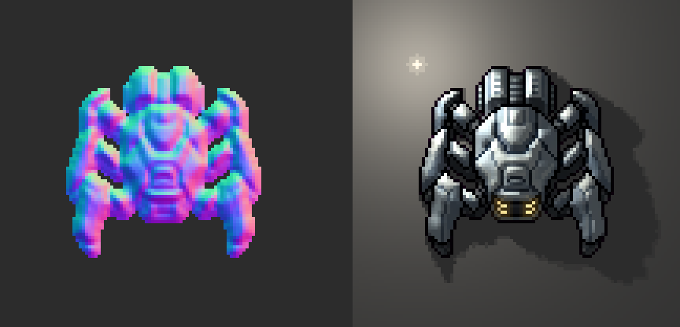

# Sprite Fusion Sprite Normals

- **Online version**: https://www.spritefusion.com/sprite-normals
- **API**: https://www.spritefusion.com/docs/pixel-art-generator/api/generate-and-transform-images#normal-maps
- **MCP**: https://www.spritefusion.com/docs/pixel-art-generator/api/mcp

A tool to generate normal maps for pixel art sprites and animations. Written in Rust, available as a CLI and a WebAssembly library.



## Why ?

**Normal maps let 2D sprites react to dynamic lighting. Ideal for 2.5D games.**

Features:

- ✅ Generate surface relief from a sprite's silhouette and shading.
- ✅ Keep the original pixel resolution and transparency.
- ✅ Process sprites, sprite sheets, and animations locally.

## Perfect for

- **2D games** with moving lights and normal-mapped sprites.
- **Pixel art animations** that need matching normal-map frames.
- **Asset pipelines** using a native CLI or browser-based processing.

## 💻 CLI

### Build from source

Requires [Rust](https://www.rust-lang.org/) 1.85 or newer. From this directory:

```bash
cargo build --release --locked
```

The binary is available at `target/release/spritefusion-sprite-normals`. To install it locally:

```bash
cargo install --path . --locked
```

### Usage

```text
spritefusion-sprite-normals <INPUT>... [OPTIONS]
```

- `<INPUT>`: PNG sprites or sheets, GIF, or APNG files.
- `-o <OUTPUT>`: Output normal PNG for one input.
- `--output-dir <DIR>`: Output directory for a batch.
- `--normal-strength <VALUE>`: Overall strength. Defaults to `1.5`.
- `--detail-strength <VALUE>`: Relief from painted shading. Defaults to `6`.
- `--detail-scale <PIXELS>`: Shading smoothing. Defaults to `0.6`.
- `--shape-strength <VALUE>`: Silhouette volume. Defaults to `1.15`.
- `--frame-size <WIDTHxHEIGHT>`: Isolate uniform PNG sheet cells.
- `--normal-format directx`: Reverse the green channel. Defaults to OpenGL.
- `--force`: Replace existing outputs. Input files are protected.

```bash
spritefusion-sprite-normals sprite.png -o sprite_n.png
spritefusion-sprite-normals sprites/*.png --output-dir normals
spritefusion-sprite-normals sprite.png -o sprite_n.png --normal-strength 2
spritefusion-sprite-normals sheet.png --frame-size 32x32 -o sheet_n.png
spritefusion-sprite-normals walk.gif -o walk_n.png
```

Without an output path, maps are saved beside their inputs as `<name>_n.png`. Run `spritefusion-sprite-normals --help` for every option.

### Animations

GIF and APNG inputs, and PNG sheets with `--frame-size`, produce three files:

- `walk_n.png`: lossless normal-map atlas.
- `walk_n.color.png`: color atlas with the same frame layout.
- `walk_n.frames.json`: atlas dimensions, frame dimensions, columns, frame count, and timing.

Frames are arranged in row-major order. `delays_ms` contains `[numerator, denominator]` pairs in milliseconds. PNG sheets keep their layout and receive a default 100 ms frame delay. Source loop counts are not exported.

Normal PNGs are data textures: disable sRGB sampling in your engine. Use artwork at its native pixel resolution. Generation estimates relief from color and shape; painted highlights can also become surface detail.

## 🌐 Web (WASM)

Build with the `wasm32-unknown-unknown` Rust target and [wasm-bindgen](https://wasm-bindgen.github.io/wasm-bindgen/) CLI `0.2.126`:

```bash
cargo build --release --target wasm32-unknown-unknown --no-default-features --locked
wasm-bindgen target/wasm32-unknown-unknown/release/spritefusion_sprite_normals.wasm --target web --out-dir pkg
```

Use the generated package in your project:

```js
import init, { generate_normal_map } from "./pkg/spritefusion_sprite_normals.js";

await init();
const result = generate_normal_map(inputBytes, JSON.stringify({ strength: 1.5 }));
try {
  const normalPng = result.normal_png;
  const colorPng = result.color_png;
  const metadata = JSON.parse(result.metadata);
  // Use these bytes to save files or create image URLs.
} finally {
  result.free();
}
```

Pass a `Uint8Array` and `"{}"` for default settings. Optional keys are `strength`, `detail`, `smoothing`, `volume`, `frame_width`, `frame_height`, and `directx`. Returned arrays own their bytes and remain valid after `free()`.

The CLI and WASM module use the same generator and animation decoder. Inputs are limited to 64 MiB and 4,194,304 pixels including processing padding; animated inputs additionally allow up to 256 frames and 4,194,304 total decoded pixels.

## Development

```bash
cargo test --locked
cargo clippy --all-targets --locked -- -D warnings
cargo fmt --check
```

## Acknowledgments

Sprite Normals is a [Sprite Fusion](https://www.spritefusion.com/pixel-art-generator) project. Sprite Fusion is a tool to generate pixel art sprites and animations for game development.

## Other open source pixel art tools

- **[Pixel Snapper](https://www.spritefusion.com/pixel-snapper)**: snap pixels to a perfect grid. Designed to fix messy and inconsistent pixel art generated by AI.


## License

[MIT License](LICENSE) — [Hugo Duprez](https://www.hugoduprez.com/).
